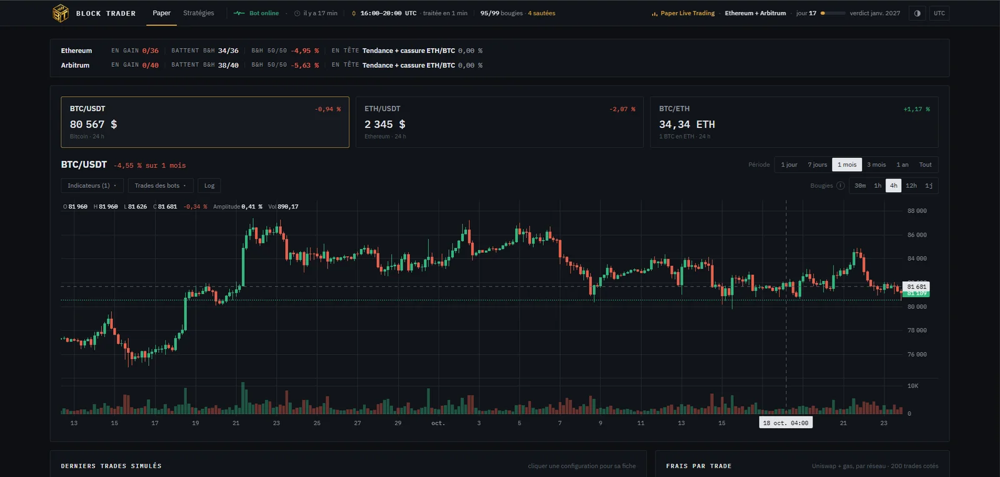
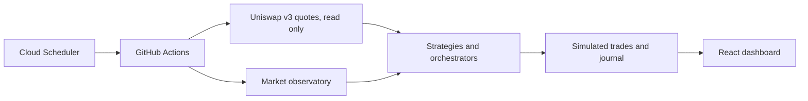

# BlockTrader

A crypto trading bot in paper trading, built to answer one question honestly: does a strategy really work, or did it just get lucky?

> **Showcase only: the code is private** and can be shown during an interview.
> **Paper trading only:** no real funds, no private key, no signing.

## The problem

Most backtests are too good to be true. After enough variants, some strategy will "work" by chance, or quietly use data from the future. An AI plugged into it would only amplify the mistake.

## The method

- **Protocol first:** each protocol is written down before any computation.
- **Every trial counts:** 3,973 trials are in the registry, across 14 protocols, failures included.
- **Correction for luck:** results are corrected for the number of trials, with the deflated Sharpe ratio.
- **Sealed test period:** a held-out period is used only once.
- **Cheating is tested:** a test injects a strategy that uses future data and checks that it gets caught.

## What it does

- **40 strategies in 6 families:** trend following, BTC or ETH rotation, diversification, buying the dips, grids, and orchestrators that allocate the capital.
- **Market observatory:** 11 public indicators, such as perpetual funding, implied volatility, stablecoins and exchange reserves, logged with their date.
- **Paper trading:** every 4 hours, on Uniswap v3 quotes read on-chain on Ethereum and Arbitrum, followed in a React dashboard.

## Safety

- The bot holds no key and signs nothing, so it cannot lose funds.
- Missing or inconsistent data pauses the bot and never opens a position.
- The CI runs with least privilege, with actions pinned by SHA.
- A guard architecture for real funds is designed (Safe, Zodiac, Cloud KMS, Ledger kill switch), not implemented.

## Where it stands

The test bench showed that none of the strategies is statistically proven on historical data. That result is the point: it avoids handing bad strategies to an AI. The paper trading test has been running since October 8, 2026, with a verdict planned for January 2027.

**Next: AI steering, not wired in yet.** An AI will choose among validated strategies under a rule that is already written: it may reduce exposure or pause, never buy or raise a limit.

## Stack

Python · NumPy · Numba · Pandas · VectorBT · web3.py · GitHub Actions · Google Cloud Scheduler · React · TypeScript

The engine is compiled with Numba and cross-checked against VectorBT and a reference loop.
